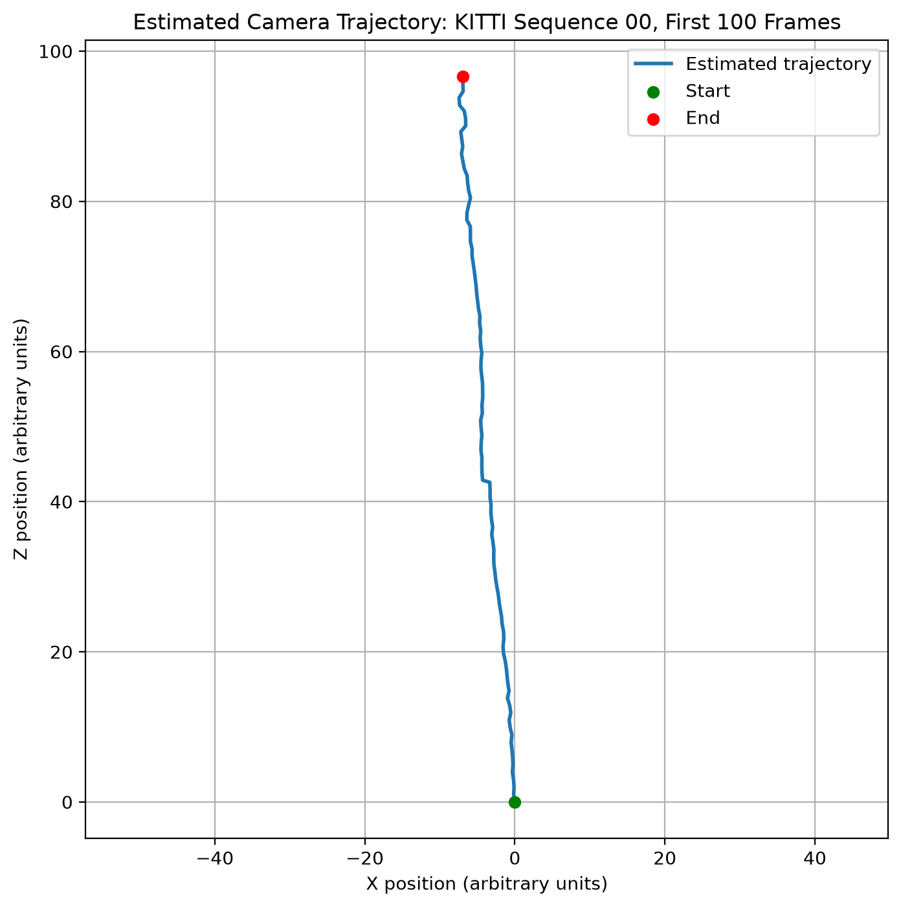
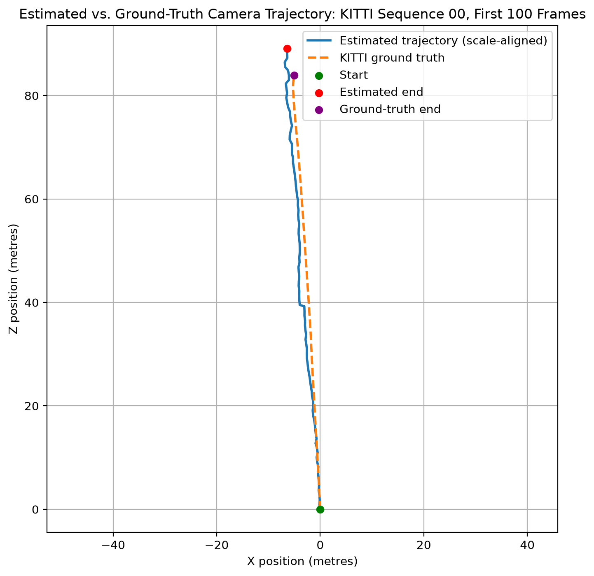
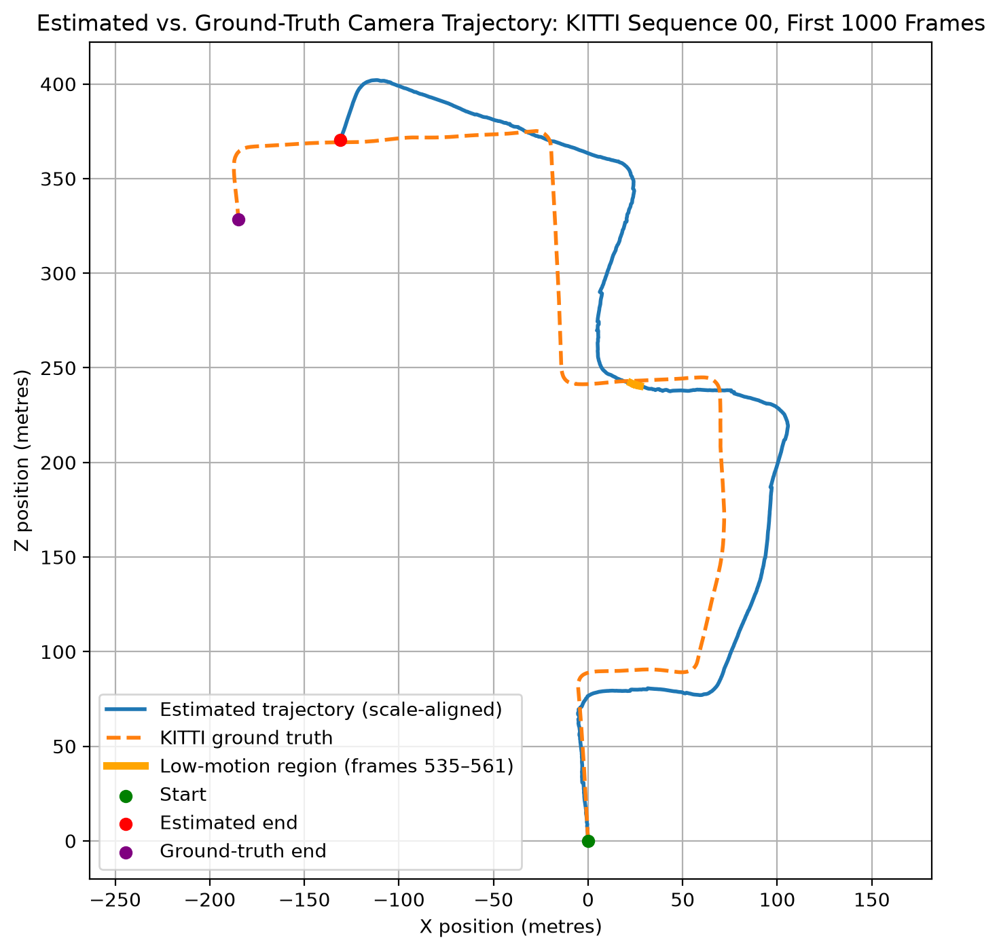

# Parallax: Monocular Visual Odometry for Autonomous Driving

Parallax is a Python-based monocular visual odometry system that estimates camera motion and reconstructs vehicle trajectories from sequences of images. Using classical computer vision techniques, including feature detection and matching, epipolar geometry, and robust motion estimation, the system tracks changes in camera position and orientation without relying on GPS.

Developed using OpenCV and evaluated on the KITTI Visual Odometry dataset, the project explores the accuracy, computational efficiency, and limitations of vision-based localisation for autonomous driving applications.

## Methodology

### ORB Keypoint Detection

ORB (Oriented FAST and Rotated BRIEF) is used to detect distinctive image features and compute binary descriptors for matching across consecutive frames. The FAST algorithm detects keypoints by comparing pixel intensities in their surrounding neighbourhoods, while BRIEF generates binary descriptors through pairwise intensity comparisons around each keypoint. The following visualization shows the ORB keypoints detected in the first frame of a driving sequence.

### Feature Matching

ORB descriptors are matched between consecutive frames using a brute-force matcher. Each ORB descriptor is a 256-bit binary string representing the local visual appearance around a keypoint. The matcher compares every descriptor in one frame against those in the next, measuring their similarity using Hamming distance, which counts the number of differing bits between two binary descriptors:

$$
d_H(\mathbf{a},\mathbf{b}) = \sum_{i=1}^{256} \mathbb{1}(a_i \neq b_i)
$$

where $\mathbb{1}$ is the indicator function, equal to 1 when the corresponding bits differ and 0 otherwise. A smaller Hamming distance indicates greater descriptor similarity.

For each descriptor, the matcher identifies its nearest neighbour (the descriptor with the smallest Hamming distance). Cross-checking is then applied to retain only pairs where both descriptors are each other's nearest neighbours, reducing ambiguous matches.

The following visualization shows the 50 best descriptor matches between the first two frames of a driving sequence, with coloured lines connecting corresponding keypoints.

### Essential Matrix Estimation

ORB feature matching is not necessarily correct: two different image features might have similar-looking descriptors, causing the matcher to pair them incorrectly. To mitigate this, we estimate an essential matrix to describe the geometric relationship between two camera views, letting us identify matches consistent with the geometry of camera motion. For a feature detected in the first image, the essential matrix predicts an epipolar line in the second image. If the feature match is geometrically correct, its corresponding point in the second image should lie on or very close to that line. 

The essential matrix is estimated using RANSAC (Random Sample Consensus). RANSAC estimates the essential matrix by repeatedly sampling subsets of feature correspondences and evaluating how well the resulting models explain the remaining matches. Matches consistent with the estimated geometry are classified as *inliers*, while inconsistent matches are classified as *outliers*. A geometric error threshold of 1 pixel is used to distinguish inliers from outliers, allowing for small inaccuracies in feature localisation.

Using the first two frames of the same driving sequence, the implementation produced the following results:

| Metric | Result |
|---|---|
| Total ORB matches | 1,221 |
| RANSAC inliers | 868 |
| RANSAC outliers | 353 |
| Inlier ratio | 71.09% |

The following visualization shows a subset of feature correspondences classified as inliers and outliers between the first two frames.

Some visually correct feature correspondences may still be classified as outliers because RANSAC evaluates their consistency with the estimated epipolar geometry rather than their visual similarity. Small inaccuracies in feature localization can cause a correct match to exceed the 1-pixel geometric error threshold and be rejected.

### Camera Pose Recovery

The essential matrix encodes the relative rotation and translation direction between two camera views:

$$
E = [\mathbf{t}]_\times R
$$

where $R$ is the $3 \times 3$ rotation matrix, $\mathbf{t}$ is the $3 \times 1$ translation vector, and $[\mathbf{t}]_\times$ is the $3 \times 3$ skew-symmetric matrix constructed from $\mathbf{t}$.

The estimated essential matrix is decomposed to recover the camera's relative rotation and translation direction. Using the matched pixel coordinates and a candidate pose, the 3D positions of corresponding features can be estimated through triangulation, allowing us to check whether they have positive depth in both camera views. Since multiple camera poses can satisfy the same essential matrix, the pose that places the most reconstructed 3D points in front of the camera in both frames is selected. As a result, some matches previously classified as RANSAC inliers may fail this additional geometric check and are excluded from the final set of inliers.

For the first two frames of the driving sequence, 699 of the 868 RANSAC inliers passed pose recovery validation. The recovered rotation was close to the identity matrix, indicating minimal change in orientation, while the estimated camera movement was predominantly forward. Because monocular visual odometry cannot determine absolute scale from two images alone, the translation is recovered as a direction rather than a distance.

### Pose Accumulation

To reconstruct the camera's trajectory across multiple frames, the relative camera poses are accumulated into a common coordinate system, with the first camera frame serving as the origin.

For each pair of consecutive frames $i$ and $i+1$, the recovered rotation $R$ and translation direction $\mathbf{t}$ are combined into a homogeneous transformation matrix:

$$
T_{i \to i+1} =
\begin{bmatrix}
R & \mathbf{t} \\
\mathbf{0}^T & 1
\end{bmatrix}
$$

Since this transformation maps 3D point coordinates from frame $i$ to frame $i+1$, it is inverted before being combined with the existing accumulated camera pose:

$$
T_{i+1} = T_i T_{i \to i+1}^{-1}
$$

where $T_i$ represents the existing accumulated camera pose at frame $i$, relative to frame 0, and $T_0=I$. Note that the inversion is necessary because the recovered transformation maps coordinates into the new camera frame, whereas pose accumulation requires the reverse transformation to express the new camera's position and orientation relative to the previous frame.

Because monocular visual odometry cannot recover absolute translation scale, each estimated translation is treated as a unit vector. The resulting trajectory therefore represents camera motion in arbitrary units rather than metres.

## Trajectory Evaluation

### Global Scale Alignment

Since estimated trajectories are represented by arbitrary units, they must aligned to ground truth using a single global scale factor. Both trajectories are first expressed relative to their initial positions.

The scale factor $s$ is calculated by minimising the sum of squared 3D position differences:

$$
s = \frac{\sum_i \hat{\mathbf{p}}_i \cdot \mathbf{p}_i^{GT}}{\sum_i \|\hat{\mathbf{p}}_i\|^2}
$$

where $\hat{\mathbf{p}}_i$ is the estimated camera position at frame $i$ and $\mathbf{p}_i^{GT}$ is the corresponding ground-truth camera position, both relative to their initial positions at frame 0.

The scale factor $s$ represents the single multiplicative factor that best matches the estimated trajectory's overall scale to ground truth, converting its arbitrary displacement units into metres.

The aligned estimated positions are then calculated as:

$$
\hat{\mathbf{p}}_i^{aligned} = s\hat{\mathbf{p}}_i
$$

Ground truth is used only for scale alignment and evaluation, not for estimating camera motion.

### Absolute Trajectory Error

Trajectory accuracy is measured using scale-aligned Absolute Trajectory Error (ATE), calculated as the root mean squared Euclidean distance between corresponding estimated and ground-truth camera positions:

$$
\mathrm{ATE}_{RMSE} =
\sqrt{\frac{1}{N}\sum_{i=0}^{N-1}
\left\|\hat{\mathbf{p}}_i^{aligned}-\mathbf{p}_i^{GT}\right\|_2^2}
$$

ATE measures the overall positional accuracy of the reconstructed trajectory after global scale alignment. Lower values indicate closer agreement with ground truth.

## Results

The visual odometry pipeline was evaluated on the first 100 frames of KITTI Odometry sequence 00.

| Metric | Result |
|---|---|
| Frames evaluated | 100 |
| Global scale factor | 0.9220 |
| Scale-aligned ATE RMSE | 2.3665 m |

### Estimated Camera Trajectory

The estimated trajectory shows predominantly forward motion along the Z-axis, with smaller lateral displacement along the X-axis. Positions are expressed in arbitrary units because absolute translation scale is not observable from monocular images alone.

### Comparison with Ground Truth

After global scale alignment, the estimated trajectory follows the overall direction of the KITTI ground-truth trajectory. However, the estimated positions gradually diverge from ground truth, particularly in the lateral direction, indicating accumulated trajectory error.

The scale-aligned ATE RMSE over the first 100 frames is 2.3665 metres. This means that after adjusting for scale, Parallax's estimated camera positions were off by about 2.37 metres overall compared to the actual positions across the first 100 frames.

These results establish an initial baseline for the monocular visual odometry pipeline. Evaluation over longer sequences is needed to better characterize accumulated drift and performance during more complex camera motion.

### Long-Range Trajectory Evaluation

The estimated trajectory follows the general shape of the ground-truth route but shows increasing positional error over longer distances, reaching a scale-aligned ATE RMSE of 41.55 m over 1,000 frames. The trajectories begin diverging before the low-motion region around frames 535–561, suggesting that the pose recovery failures were not the primary source of error. Differences in the estimated travel distances along various sections of the route indicate that monocular scale ambiguity may be a significant contributor to the accumulated drift.

## Challenges and Limitations

### Pose Recovery During Low-Motion Frames

During evaluation on the first 1,000 frames of KITTI sequence 00, the pipeline encountered 13 pose recovery failures, concentrated around frames 535–561. Despite a high number of feature matches and RANSAC inliers, OpenCV's `recoverPose()` could not recover a valid camera pose for these frame pairs. This is likely because the inliers did not provide enough reliable information to validate the camera's movement.

Inspection of the corresponding images revealed that the vehicle was approaching a yield sign. Analysis of KITTI ground-truth poses and timestamps confirmed that the vehicle decelerated from approximately 21 km/h to nearly 0 km/h before accelerating again.

This highlighted a limitation of essential-matrix-based motion estimation: when camera movement is really small, there may be insufficient change between consecutive images to reliably estimate its movement direction.

To prevent individual failures from terminating the pipeline, a fallback was implemented that retains the previous camera pose when pose recovery fails. Although this enables longer trajectory reconstruction, it assumes zero movement during failed frame pairs and may introduce additional error.

### Monocular Scale Ambiguity

Since we are working with monocoluar imaging, we cannot recover translation magnitude. Instead, we use a unit-length translation vector, so the current implementation assigns the same translation magnitude to every successfully processed frame pair, regardless of the vehicle's actual displacement. This assumption becomes problematic when the vehicle accelerates, decelerates, or stops.

To evaluate the reconstructed trajectory in metres, a single global scale factor is fitted using KITTI ground-truth positions. This corrects the final estimated position, but it cannot correct differences in displacement between individual frame pairs, since it applies the same multiplier to every estimated translation. Ideally, a different translation magnitude would be needed for each frame pair.

Consequently, the reconstructed trajectory remains subject to scale-related errors even after alignment.

### Accumulated Trajectory Drift

Because each camera pose is calculated from the previous accumulated pose, errors in relative rotation and translation propagate through subsequent estimates.

Evaluation on KITTI sequence 00 demonstrated increasing scale-aligned Absolute Trajectory Error (ATE) as the evaluated sequence length increased:

| Frames | Global Scale Factor | ATE RMSE |
|---|---:|---:|
| 100 | 0.9220 | 2.3665 m |
| 250 | 0.7709 | 12.5190 m |
| 500 | 0.7310 | 26.7930 m |
| 1,000 | 0.7201 | 41.5530 m |

These results demonstrate the limitations of the current monocular visual odometry baseline over longer sequences. Potential contributors include inaccurate relative motion estimates, unknown per-frame translation scale, and approximations made during pose recovery failures.

### Analysis of Trajectory Error

Visual comparison of the estimated and ground-truth trajectories over 1,000 frames showed that the pipeline captured the general shape of the route, but accumulated substantial positional error.

Although 13 pose recovery failures occurred around frames 535–561, the trajectories had already begun diverging before this region, with no obvious sudden increase in error near the vehicle's stop. This suggests that the failures were not the primary source of the overall trajectory error.

Instead, the differences in estimated travel distances along various sections of the route suggest that monocular scale ambiguity may be a significant contributor. To investigate this, the next step is to compare the current baseline against a diagnostic trajectory constructed using ground-truth frame-to-frame displacement magnitudes and estimated camera motion directions.

This experiment will help distinguish errors caused by translation scale from those caused by inaccurate rotation and translation-direction estimates. Ground-truth displacement will be used only for diagnosis, not as part of the final visual odometry pipeline.

## Dataset

This project uses the [KITTI Visual Odometry Dataset](https://www.cvlibs.net/datasets/kitti/eval_odometry.php) to develop and evaluate camera-based vehicle localization algorithms.

The dataset is used for educational and research purposes and is not redistributed through this repository. Users must download the data separately from the official KITTI website and comply with its licensing and usage terms.

**Reference:**

Geiger, A., Lenz, P., & Urtasun, R. (2012). *Are we ready for autonomous driving? The KITTI Vision Benchmark Suite.* IEEE Conference on Computer Vision and Pattern Recognition (CVPR).

## Licence

The original source code in this repository is licensed under the MIT Licence. See the [LICENSE](LICENSE) file for details.

The KITTI dataset and any third-party materials are subject to their respective licences and are not covered by this project's MIT Licence.

