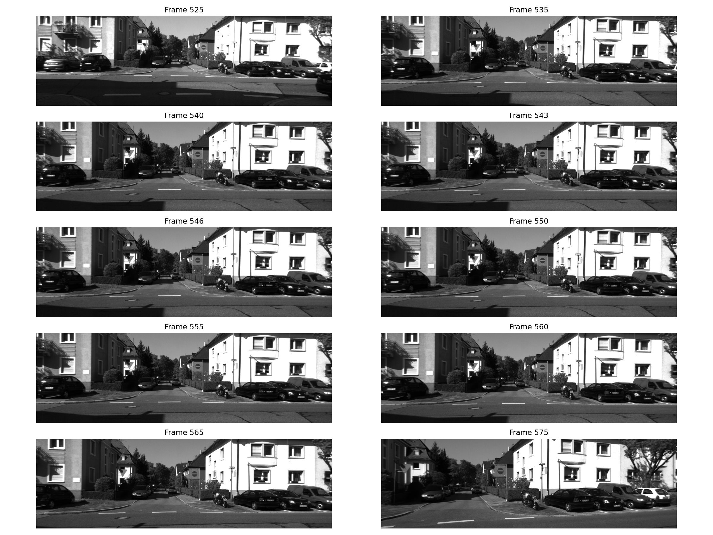
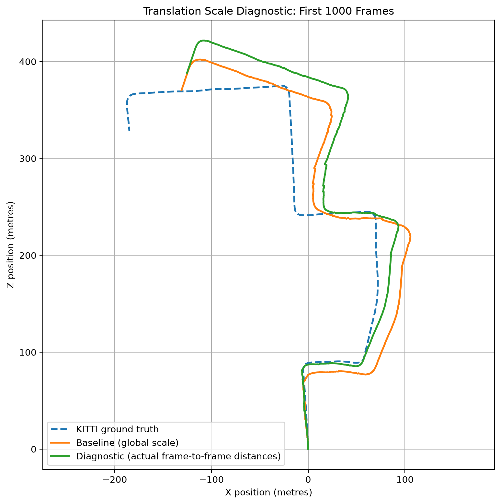
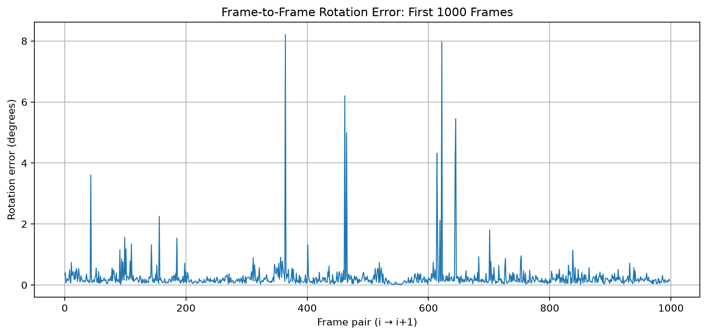
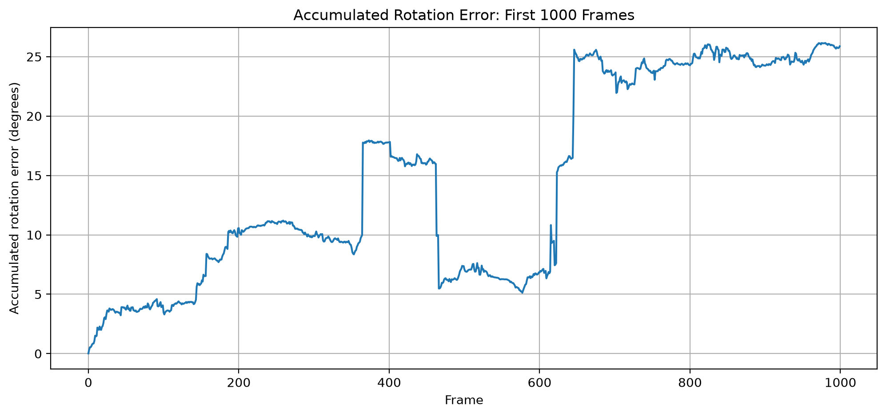
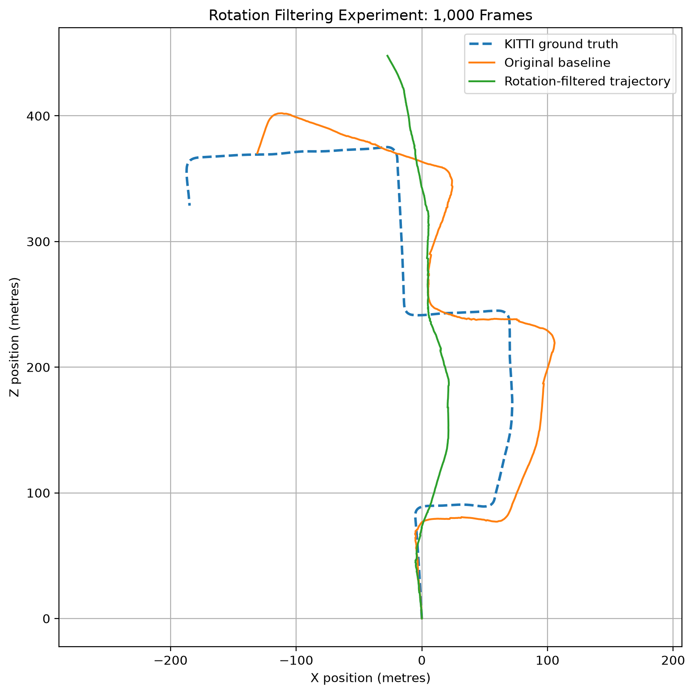
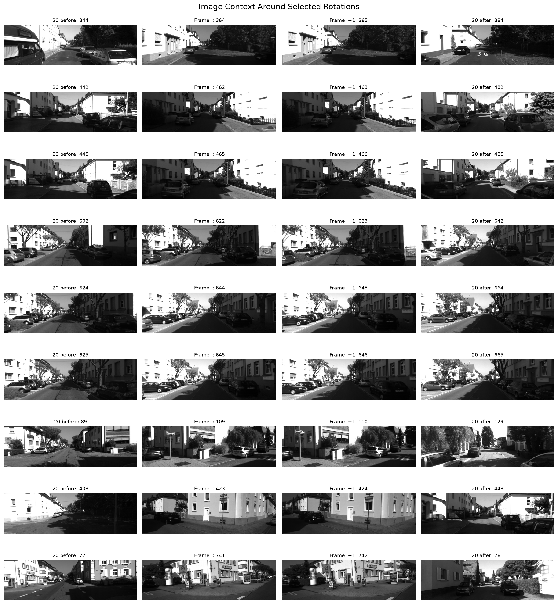
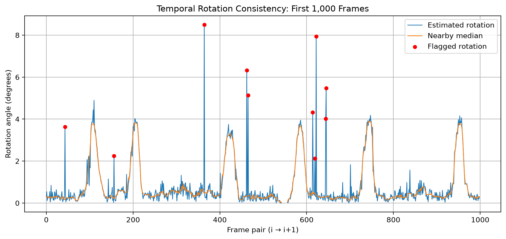
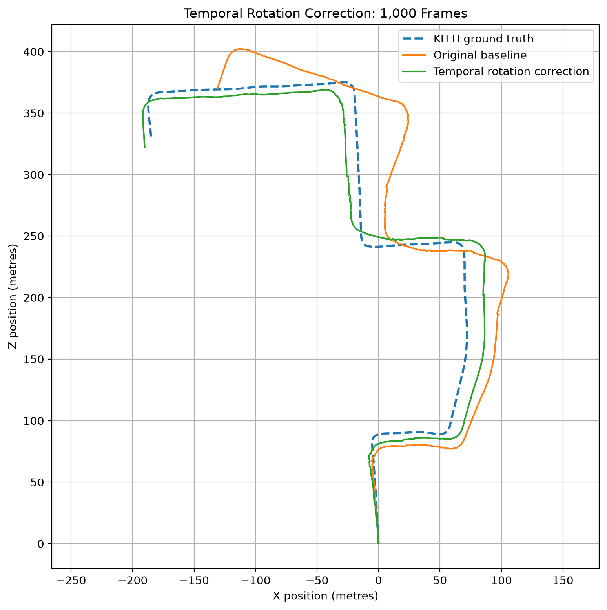
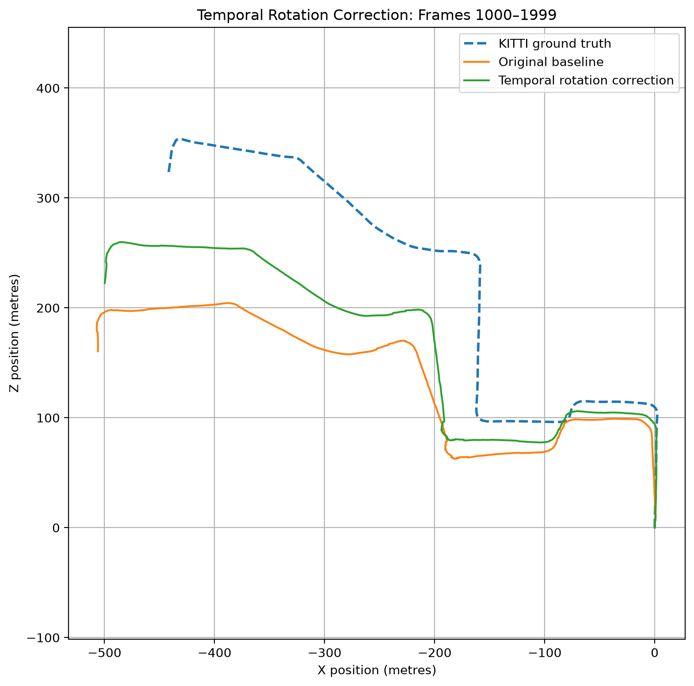

# Parallax: Monocular Visual Odometry for Autonomous Driving

Parallax is a Python-based monocular visual odometry system that estimates camera motion and reconstructs vehicle trajectories from sequences of images. Using classical computer vision techniques, including feature detection and matching, epipolar geometry, and robust motion estimation, the system tracks changes in camera position and orientation without relying on GPS.

Developed using OpenCV and evaluated on the KITTI Visual Odometry dataset, the project explores the accuracy, computational efficiency, and limitations of vision-based localisation for autonomous driving applications.

## Methodology

### ORB Keypoint Detection

ORB (Oriented FAST and Rotated BRIEF) is used to detect distinctive image features and compute binary descriptors for matching across consecutive frames. The FAST algorithm detects keypoints by comparing pixel intensities in their surrounding neighbourhoods, while BRIEF generates binary descriptors through pairwise intensity comparisons around each keypoint. The following visualization shows the ORB keypoints detected in the first frame of a driving sequence.


### Feature Matching

ORB descriptors are matched between consecutive frames using a brute-force matcher. Each ORB descriptor is a 256-bit binary string representing the local visual appearance around a keypoint. The matcher compares every descriptor in one frame against those in the next, measuring their similarity using Hamming distance, which counts the number of differing bits between two binary descriptors:

$$
d_H(\mathbf{a},\mathbf{b}) = \sum_{i=1}^{256} \mathbb{1}(a_i \neq b_i)
$$

where $\mathbb{1}$ is the indicator function, equal to 1 when the corresponding bits differ and 0 otherwise. A smaller Hamming distance indicates greater descriptor similarity.

For each descriptor, the matcher identifies its nearest neighbour (the descriptor with the smallest Hamming distance). Cross-checking is then applied to retain only pairs where both descriptors are each other's nearest neighbours, reducing ambiguous matches.

The following visualization shows the 50 best descriptor matches between the first two frames of a driving sequence, with coloured lines connecting corresponding keypoints.


### Essential Matrix Estimation

ORB feature matching is not necessarily correct: two different image features might have similar-looking descriptors, causing the matcher to pair them incorrectly. To mitigate this, we estimate an essential matrix to describe the geometric relationship between two camera views, letting us identify matches consistent with the geometry of camera motion. For a feature detected in the first image, the essential matrix predicts an epipolar line in the second image. If the feature match is geometrically correct, its corresponding point in the second image should lie on or very close to that line. 

The essential matrix is estimated using RANSAC (Random Sample Consensus). RANSAC estimates the essential matrix by repeatedly sampling subsets of feature correspondences and evaluating how well the resulting models explain the remaining matches. Matches consistent with the estimated geometry are classified as *inliers*, while inconsistent matches are classified as *outliers*. A geometric error threshold of 1 pixel is used to distinguish inliers from outliers, allowing for small inaccuracies in feature localisation.

Using the first two frames of the same driving sequence, the implementation produced the following results:

| Metric | Result |
|---|---|
| Total ORB matches | 1,221 |
| RANSAC inliers | 868 |
| RANSAC outliers | 353 |
| Inlier ratio | 71.09% |

The following visualization shows a subset of feature correspondences classified as inliers and outliers between the first two frames.


Some visually correct feature correspondences may still be classified as outliers because RANSAC evaluates their consistency with the estimated epipolar geometry rather than their visual similarity. Small inaccuracies in feature localization can cause a correct match to exceed the 1-pixel geometric error threshold and be rejected.

### Camera Pose Recovery

The essential matrix encodes the relative rotation and translation direction between two camera views:

$$
E = [\mathbf{t}]_\times R
$$

where $R$ is the $3 \times 3$ rotation matrix, $\mathbf{t}$ is the $3 \times 1$ translation vector, and $[\mathbf{t}]_\times$ is the $3 \times 3$ skew-symmetric matrix constructed from $\mathbf{t}$.

The estimated essential matrix is decomposed to recover the camera's relative rotation and translation direction. Using the matched pixel coordinates and a candidate pose, the 3D positions of corresponding features can be estimated through triangulation, allowing us to check whether they have positive depth in both camera views. Since multiple camera poses can satisfy the same essential matrix, the pose that places the most reconstructed 3D points in front of the camera in both frames is selected. As a result, some matches previously classified as RANSAC inliers may fail this additional geometric check and are excluded from the final set of inliers.

For the first two frames of the driving sequence, 699 of the 868 RANSAC inliers passed pose recovery validation. The recovered rotation was close to the identity matrix, indicating minimal change in orientation, while the estimated camera movement was predominantly forward. Because monocular visual odometry cannot determine absolute scale from two images alone, the translation is recovered as a direction rather than a distance.

### Pose Accumulation

To reconstruct the camera's trajectory across multiple frames, the relative camera poses are accumulated into a common coordinate system, with the first camera frame serving as the origin.

For each pair of consecutive frames $i$ and $i+1$, the recovered rotation $R$ and translation direction $\mathbf{t}$ are combined into a homogeneous transformation matrix:

$$
T_{i \to i+1} =
\begin{bmatrix}
R & \mathbf{t} \\
\mathbf{0}^T & 1
\end{bmatrix}
$$

Since this transformation maps 3D point coordinates from frame $i$ to frame $i+1$, it is inverted before being combined with the existing accumulated camera pose:

$$
T_{i+1} = T_i T_{i \to i+1}^{-1}
$$

where $T_i$ represents the existing accumulated camera pose at frame $i$, relative to frame 0, and $T_0=I$. Note that the inversion is necessary because the recovered transformation maps coordinates into the new camera frame, whereas pose accumulation requires the reverse transformation to express the new camera's position and orientation relative to the previous frame.

Because monocular visual odometry cannot recover absolute translation scale, each estimated translation is treated as a unit vector. The resulting trajectory therefore represents camera motion in arbitrary units rather than metres.

## Trajectory Evaluation

### Global Scale Alignment

Since estimated trajectories are represented by arbitrary units, they must be aligned to ground truth using a single global scale factor. Both trajectories are first expressed relative to their initial positions.

The scale factor $s$ is calculated by minimising the sum of squared 3D position differences:

$$
s = \frac{\sum_i \hat{\mathbf{p}}_i \cdot \mathbf{p}_i^{GT}}{\sum_i \|\hat{\mathbf{p}}_i\|^2}
$$

where $\hat{\mathbf{p}}_i$ is the estimated camera position at frame $i$ and $\mathbf{p}_i^{GT}$ is the corresponding ground-truth camera position, both relative to their initial positions at frame 0.

The scale factor $s$ represents the single multiplicative factor that best matches the estimated trajectory's overall scale to ground truth, converting its arbitrary displacement units into metres.

The aligned estimated positions are then calculated as:

$$
\hat{\mathbf{p}}_i^{aligned} = s\hat{\mathbf{p}}_i
$$

Ground truth is used only for scale alignment and evaluation, not for estimating camera motion.

### Absolute Trajectory Error

Trajectory accuracy is measured using scale-aligned Absolute Trajectory Error (ATE), calculated as the root mean squared Euclidean distance between corresponding estimated and ground-truth camera positions:

$$
\mathrm{ATE}_{RMSE} =
\sqrt{\frac{1}{N}\sum_{i=0}^{N-1}
\left\|\hat{\mathbf{p}}_i^{aligned}-\mathbf{p}_i^{GT}\right\|_2^2}
$$

ATE measures the overall positional accuracy of the reconstructed trajectory after global scale alignment. Lower values indicate closer agreement with ground truth.

## Testing

Automated unit tests verify core functionality, including:

- KITTI data loading and parsing
- Camera pose transformations and accumulation
- Global scale alignment and Absolute Trajectory Error (ATE) calculations
- Temporal rotation outlier detection and correction

Run all tests from the repository root:

```bash
python -m pytest -v
```

All 17 tests use synthetic data and do not require the KITTI dataset.

## Results and Limitations

The visual odometry pipeline was evaluated on the first 100 frames of KITTI Odometry sequence 00.

| Metric | Result |
|---|---|
| Frames evaluated | 100 |
| Global scale factor | 0.9220 |
| Scale-aligned ATE RMSE | 2.3665 m |

### Estimated Camera Trajectory


The estimated trajectory shows predominantly forward motion along the Z-axis, with smaller lateral displacement along the X-axis. Positions are expressed in arbitrary units because absolute translation scale is not observable from monocular images alone.

### Comparison with Ground Truth


After global scale alignment, the estimated trajectory follows the overall direction of the KITTI ground-truth trajectory. However, the estimated positions gradually diverge from ground truth, particularly in the lateral direction, indicating accumulated trajectory error.

The scale-aligned ATE RMSE over the first 100 frames is 2.3665 metres. This means that after adjusting for scale, Parallax's estimated camera positions were off by about 2.37 metres overall compared to the actual positions across the first 100 frames.

These results establish an initial baseline for the monocular visual odometry pipeline. Evaluation over longer sequences is needed to better characterize accumulated drift and performance during more complex camera motion.

### Pose Recovery During Low-Motion Frames

During evaluation on the first 1,000 frames of KITTI sequence 00, the pipeline encountered 13 pose recovery failures, concentrated around frames 535–561. Despite a high number of feature matches and RANSAC inliers, OpenCV's `recoverPose()` could not recover a valid camera pose for these frame pairs. This is likely because the inliers did not provide enough reliable information to validate the camera's movement.



Inspection of the corresponding images revealed that the vehicle was approaching a yield sign. Analysis of KITTI ground-truth poses and timestamps confirmed that the vehicle decelerated from approximately 21 km/h to nearly 0 km/h before accelerating again.

This highlighted a limitation of essential-matrix-based motion estimation: when camera movement is really small, there may be insufficient change between consecutive images to reliably estimate its movement direction.

To prevent individual failures from terminating the pipeline, a fallback was implemented that retains the previous camera pose when pose recovery fails. Although this enables longer trajectory reconstruction, it assumes zero movement during failed frame pairs and may introduce additional error.

### Long-Range Trajectory Evaluation

To evaluate how positional error accumulates over longer sequences, the pipeline was tested on progressively larger frame ranges.

| Frames | Global Scale Factor | ATE RMSE |
|---|---:|---:|
| 100 | 0.9220 | 2.3665 m |
| 250 | 0.7709 | 12.5190 m |
| 500 | 0.7310 | 26.7930 m |
| 1,000 | 0.7201 | 41.5530 m |

Each frame range was evaluated using a separately optimised global scale factor. The increasing ATE demonstrates how positional errors accumulate as the reconstructed trajectory becomes longer.


The estimated trajectory follows the general shape of the ground-truth route but shows increasing positional error over longer distances, reaching a scale-aligned ATE RMSE of 41.55 m over 1,000 frames. The trajectories begin diverging before the low-motion region around frames 535–561, suggesting that the pose recovery failures were not the primary source of error. 

Since we are working with monocoluar imaging, we cannot recover translation magnitude. Instead, we use a unit-length translation vector, so the current implementation assigns the same translation magnitude to every successfully processed frame pair, regardless of the vehicle's actual displacement. This assumption becomes problematic when the vehicle accelerates, decelerates, or stops.

To evaluate the reconstructed trajectory in metres, a single global scale factor is fitted using KITTI ground-truth positions. This corrects the final estimated position, but it cannot correct differences in displacement between individual frame pairs. This is because every individual translation vector has a magnitude of 1, so multiplying them all by the same factor produces translation vectors with the same magnitude, but the car actually travels different distances between frames.

Differences in the estimated travel distances along various sections of the route indicate that monocular scale ambiguity may be a significant contributor to the accumulated drift.

### Translation Scale Diagnostic

To investigate whether incorrect translation magnitudes were a major source of accumulated trajectory error, a diagnostic experiment was conducted using KITTI ground-truth frame-to-frame distances.

The original visual odometry pipeline assigns a unit-length translation to every successfully processed frame pair. For this experiment, the estimated displacement vectors were multiplied by their corresponding ground-truth distances, preserving the estimated movement directions while correcting their magnitudes to the true distance. The corrected displacements were then accumulated to reconstruct a new trajectory.



| Approach | ATE RMSE |
|---|---:|
| Original trajectory (global scale alignment) | 41.5530 m |
| Diagnostic trajectory (ground-truth distances, no global scale alignment) | 46.8495 m |

Replacing the unit-length translations with actual frame-to-frame distances increased ATE RMSE from 41.55 m to 46.85 m over 1,000 frames.

Although the diagnostic trajectory accounts for the vehicle's actual displacement magnitudes, it still deviates substantially from ground truth. This indicates that correcting translation magnitudes alone is insufficient to resolve the accumulated trajectory drift, suggesting that errors in estimated movement directions and camera orientations also contribute.

The higher ATE produced by the diagnostic trajectory does not mean that assigning equal translation magnitudes is more accurate. Since the estimated movement directions may still be incorrect, the globally optimized scale factor used in the baseline can sometimes place estimated positions closer to ground truth, while using the actual displacement magnitudes in the diagnostic may place them farther.

Ground-truth distances were used exclusively for this diagnostic experiment and are not incorporated into the visual odometry pipeline.

### Frame-to-Frame Rotation Error Analysis

Since correcting translation magnitudes did not improve trajectory accuracy, the estimated camera rotations were analyzed to investigate another potential source of drift. Rotation describes the change in the camera's orientation between frames, including turning left or right, tilting up or down, and rolling sideways. Errors in estimated rotations can cause positional drift because each camera movement is transformed into the global coordinate system using the accumulated camera orientation, so an incorrect orientation causes subsequent movements to be accumulated in the wrong direction.

For each consecutive frame pair, the estimated relative rotation was compared against the corresponding KITTI ground-truth rotation. The difference was expressed as a rotation angle in degrees.



| Metric | Rotation Error |
|---|---:|
| Mean | 0.2551° |
| Median | 0.1557° |
| Maximum | 8.2092° |
| RMSE | 0.6000° |

Most frame-to-frame rotation estimates exhibited relatively small errors, with a median of approximately 0.16°. However, several isolated errors reached as high as 8.21°, particularly around frames 365, 460, and 620–640.

These spikes suggest that rotation estimation becomes unreliable for certain frame pairs. Potential causes include incorrect feature correspondences, insufficient parallax, and instability during essential matrix estimation or pose recovery.

Although the typical frame-to-frame errors are small, even occasional inaccurate rotations can affect subsequent camera poses when transformations are accumulated over time.

### Accumulated Rotation Error Analysis

To investigate how individual rotation errors affect long-term orientation accuracy, the accumulated camera orientation at each frame was compared against the corresponding KITTI ground-truth orientation.

Unlike the frame-to-frame analysis, which measures errors in individual relative rotations, this experiment measures the difference between the estimated and actual camera orientations after accumulating all preceding transformations.



| Metric | Accumulated Rotation Error |
|---|---:|
| Mean | 14.4719° |
| Median | 11.0316° |
| Maximum | 26.1557° |
| Final frame | 25.8765° |

Despite relatively small frame-to-frame rotation errors, the accumulated orientation error reached approximately 25.88° by frame 999.

The accumulated error exhibited abrupt changes around frames 365, 460, and 620–640, corresponding to several of the largest individual rotation errors. This suggests that occasional inaccurate rotation estimates can have persistent effects on the reconstructed camera orientation. Some later errors may also partially cancel earlier errors, explaining why accumulated rotation error does not increase continuously.

Since accumulated camera orientations determine how subsequent translation vectors are transformed into the global coordinate system, orientation drift is a likely contributor to the observed positional drift.

These findings suggest that improving the reliability of relative rotation estimation could help reduce accumulated trajectory drift. 

### Investigation of Large Rotation Errors

To investigate the unusually large frame-to-frame rotation errors, selected frame pairs were examined in greater detail. The analysis compared feature-match counts, RANSAC inliers, pose recovery inliers, estimated rotations, ground-truth rotations, and image feature displacement.

Several frame pairs produced rotation estimates between 4° and 8°, despite KITTI ground truth indicating actual rotations below 1°. These inaccurate estimates occurred even when hundreds of feature matches and RANSAC inliers were available, demonstrating that a high inlier count does not necessarily guarantee accurate pose estimation.

These findings motivated an investigation into whether unreliable rotations could be detected and corrected before they propagated through the accumulated camera trajectory.

### Experiment: Fixed Rotation Threshold

An initial experiment attempted to reduce accumulated orientation drift by replacing any estimated frame-to-frame rotation exceeding 2° with the identity matrix, representing no change in camera orientation.

This approach rejected 144 rotations.



| Metric | Original Baseline | Fixed Rotation Threshold |
|---|---:|---:|
| ATE RMSE | 41.5530 m | 75.2892 m |
| Final accumulated rotation error | 25.8765° | 156.5650° |

The fixed-threshold approach substantially worsened both positional and orientation accuracy. Visual comparison showed that the filtered trajectory failed to reproduce several major turns.

This demonstrated that large rotation magnitudes are not necessarily inaccurate and that a fixed threshold cannot reliably distinguish incorrect estimates from genuine camera motion.

### Temporal Rotation Consistency

To better distinguish incorrect rotation estimates from genuine vehicle turns, the surrounding images of selected high-rotation frame pairs were visually inspected.



Inspection revealed that some large estimated rotations corresponded to genuine turns, while others occurred during sequences where the vehicle appeared to continue in approximately the same direction. This motivated using information from neighbouring frames to determine whether a large rotation estimate was consistent with the vehicle's surrounding motion.

A temporal consistency check was implemented using the five preceding and five following frame pairs. For each rotation estimate, the median magnitude of these neighbouring rotations was calculated. An estimate was flagged as suspicious only if its rotation magnitude exceeded 2° *and* three times the neighbouring median.



The method flagged 10 rotations, all of which were confirmed against KITTI ground truth to have errors exceeding 2°, and no rotations were incorrectly flagged. Thus, this method achieved 100% precision and recall on the evaluated sequence.

### Experiment: Temporal Rotation Correction

Rather than replacing flagged rotations with the identity matrix, as in the previous experiment, suspicious rotations were replaced with estimates derived from neighbouring camera motion.

The surrounding rotation matrices were converted into rotation vectors using OpenCV's `Rodrigues()` function. Unlike rotation angles alone, these vectors represent both the magnitude and axis of rotation. The component-wise median of the neighbouring rotation vectors was then calculated and converted back into a rotation matrix to be used as the corrected rotation estimate for the flagged rotation. Other flagged rotations and failed pose recoveries were excluded from this calculation.

The corrected rotations were accumulated with the original estimated translations to reconstruct a new camera trajectory.



| Metric | Original Baseline | Temporal Correction |
|---|---:|---:|
| Global scale factor | 0.7201 | 0.7469 |
| ATE RMSE | 41.5530 m | 14.5524 m |
| Final accumulated rotation error | 25.8765° | 7.9423° |

Correcting only 10 rotation estimates reduced ATE RMSE by approximately **65.0%** and final accumulated orientation error by **69.3%** over 1,000 frames.

These results demonstrate that a small number of inaccurate rotation estimates contributed substantially to accumulated trajectory drift. Unlike the fixed-threshold approach, temporal correction preserved sustained vehicle turns while reducing the effects of isolated rotation errors.

Temporal rotation detection and correction are implemented in `src/geometry/temporal.py` and used by both the development and validation scripts.

**Limitation:** The correction requires information from future frames, making the current approach suitable for offline trajectory reconstruction rather than real-time estimation.

### Validation on Unseen Frames

To evaluate whether the temporal rotation correction generalises beyond the frames used during development, the method was tested on frames 1000–1999 of KITTI sequence 00, using the same detection thresholds and correction procedure.

Both trajectories were initialized at frame 1000, with KITTI ground-truth poses transformed into the corresponding starting coordinate system for comparison.



| Metric | Original Baseline | Temporal Correction |
|---|---:|---:|
| Global scale factor | 0.7479 | 0.7760 |
| ATE RMSE | 100.4963 m | 66.6250 m |
| Final accumulated rotation error | 10.5705° | 5.2233° |

The method identified and corrected 5 suspicious rotations, reducing ATE RMSE by approximately **33.7%** and final accumulated rotation error by **50.6%**.

These results demonstrate that temporal rotation correction also improves trajectory accuracy on previously unseen frames, although substantial positional drift remains. Further evaluation on additional KITTI sequences would provide stronger evidence of generalization across different driving conditions.

## Dataset

This project uses the [KITTI Visual Odometry Dataset](https://www.cvlibs.net/datasets/kitti/eval_odometry.php) to develop and evaluate camera-based vehicle localization algorithms.

The dataset is used for educational and research purposes and is not redistributed through this repository. Users must download the data separately from the official KITTI website and comply with its licensing and usage terms.

**Reference:**

Geiger, A., Lenz, P., & Urtasun, R. (2012). *Are we ready for autonomous driving? The KITTI Vision Benchmark Suite.* IEEE Conference on Computer Vision and Pattern Recognition (CVPR).

## Licence

The original source code in this repository is licensed under the MIT Licence. See the [LICENSE](LICENSE) file for details.

The KITTI dataset and any third-party materials are subject to their respective licences and are not covered by this project's MIT Licence.


